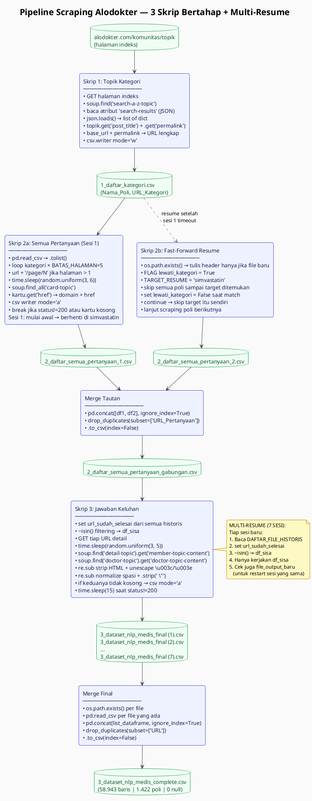

# Scraping Data — `3_dataset_nlp_medis_complete.csv` (dari Alodokter)

> Dokumen ini menjelaskan **persis** bagaimana dataset tanya-jawab medis dikumpulkan dari
> komunitas Alodokter — mulai dari ekstraksi daftar kategori, pengumpulan tautan pertanyaan,
> hingga ekstraksi isi tanya-jawab — lengkap dengan **strategi multi-sesi** untuk mengatasi
> timeout Kaggle.
>
> Sumber: `alodokter.com/komunitas` → pipeline **3 skrip bertahap** (`Skrip 1: Topik Kategori`
> → `Skrip 2: Semua Pertanyaan` → `Skrip 3: Jawaban Keluhan`), dijalankan di **Kaggle Notebook**.

---

## TL;DR — tiga tahap, satu dataset

| Tahap | Nama Cell | Apa yang dilakukan | Output |
|---|---|---|---|
| **1 — Kategori** | `Topik Kategori` | Ekstrak daftar semua topik/poli dari halaman indeks Alodokter | `1_daftar_kategori.csv` |
| **2a — Tautan (Sesi 1)** | `Semua Pertanyaan Tiap Topik` (skrip pertama) | Per kategori, sapu hingga 5 halaman → kumpulkan URL tiap pertanyaan | `2_daftar_semua_pertanyaan_1.csv` |
| **2b — Tautan (Sesi 2)** | `Semua Pertanyaan Tiap Topik` (skrip kedua) | Fast-forward resume dari `simvastatin`; cegah overwrite | `2_daftar_semua_pertanyaan_2.csv` |
| **2c — Merge Tautan** | `Semua Pertanyaan Tiap Topik` (skrip ketiga) | Gabungkan dua file tautan, drop duplikat | `2_daftar_semua_pertanyaan_gabungan.csv` |
| **3 — Konten** | `Jawaban Keluhan` (skrip pertama) | Per URL, ekstrak `Keluhan` + `Jawaban_Dokter`; simpan bertahap multi-resume 7 sesi | `3_dataset_nlp_medis_final (1–7).csv` |
| **3 — Merge Final** | `Jawaban Keluhan` (skrip kedua) | Gabungkan 7 pecahan → 1 master | `3_dataset_nlp_medis_complete.csv` |

**Hasil akhir:** **58.943 baris** data tanya-jawab medis, **1.422 kategori poli**, **0 null** di semua kolom.

**Strategi kunci:** karena Kaggle Notebook punya batas waktu eksekusi, scraping Tahap 3 dipecah
menjadi **7 sesi** dengan mekanisme **multi-resume** — setiap sesi baru membaca riwayat sesi
sebelumnya dari file historis, lalu hanya mengerjakan URL yang belum selesai.

---

## 1. Skrip 1 — Ekstraksi Topik Kategori (`Topik Kategori`)

**File output:** `1_daftar_kategori.csv`  
**Kolom:** `Nama_Poli`, `URL_Kategori`

Alodokter menyimpan daftar semua topik komunitas dalam format **JSON tersembunyi** di dalam
atribut elemen HTML kustom `<search-a-z-topic search-results="[...]">`. Skrip ini membongkarnya.

### 1.1 Library & Konfigurasi Awal

```python
import requests
from bs4 import BeautifulSoup
import json
import csv

file_kategori = '1_daftar_kategori.csv'
url_indeks_utama = "https://www.alodokter.com/komunitas/topik"
base_url = "https://www.alodokter.com/komunitas/topic-tag/"

headers = {
    "User-Agent": "Mozilla/5.0 (Windows NT 10.0; Win64; x64) AppleWebKit/537.36 (KHTML, like Gecko) Chrome/120.0.0.0 Safari/537.36"
}
```

- **`requests`** — HTTP client untuk melakukan `GET` request ke Alodokter.
- **`BeautifulSoup`** — HTML parser; dipakai untuk mencari elemen tertentu dalam DOM.
- **`json`** — Dipakai untuk `json.loads()`, mengubah string JSON mentah (dari atribut HTML) menjadi objek Python yang bisa diiterasi.
- **`csv`** — Dipakai untuk menulis output ke file CSV dengan `csv.writer`.
- **`headers` (User-Agent)** — Meniru browser Chrome agar tidak langsung diblokir oleh server Alodokter sebagai bot.
- **`base_url`** — Prefix tetap untuk semua URL kategori. Digabungkan dengan `permalink` dari JSON untuk membentuk URL lengkap.

### 1.2 GET Request & Parsing HTML

```python
response = requests.get(url_indeks_utama, headers=headers)

if response.status_code != 200:
    print(f"Gagal mengakses halaman. Status code: {response.status_code}")
else:
    soup = BeautifulSoup(response.text, 'html.parser')
```

- `requests.get()` mengirim HTTP GET ke `https://www.alodokter.com/komunitas/topik`.
- `response.status_code` dicek dulu — kalau bukan `200 OK`, eksekusi berhenti dengan pesan error. Ini penting agar kode tidak crash saat parsing HTML yang mungkin kosong atau berisi halaman error.
- `BeautifulSoup(response.text, 'html.parser')` mengubah string HTML mentah menjadi objek yang bisa diquery dengan method `.find()`, `.find_all()`, dsb.

### 1.3 Membongkar JSON Tersembunyi

```python
elemen_pencarian = soup.find('search-a-z-topic')

if elemen_pencarian and elemen_pencarian.has_attr('search-results'):
    data_json_mentah = elemen_pencarian['search-results']

    try:
        daftar_topik = json.loads(data_json_mentah)
    except json.JSONDecodeError as e:
        print(f"Gagal memecah JSON: {e}")
```

- `soup.find('search-a-z-topic')` — Mencari elemen HTML non-standar (custom web component) yang khusus dipakai Alodokter sebagai tempat menyimpan data topik. Elemen ini tidak terlihat di halaman tetapi ada di source HTML.
- `.has_attr('search-results')` — Validasi defensif sebelum mencoba membaca atribut. Kalau struktur web Alodokter berubah dan atribut ini hilang, kode tidak crash dengan `AttributeError`.
- `elemen_pencarian['search-results']` — Membaca nilai atribut tersebut; hasilnya adalah **string JSON** berisi array of objects, misalnya: `[{"post_title":"Ablasi Retina","permalink":"ablasi-retina"}, ...]`.
- `json.loads(data_json_mentah)` — Mengubah string JSON tersebut menjadi **list of Python dictionaries** yang bisa diiterasi. `try/except json.JSONDecodeError` menangkap kasus di mana string JSON malformed (misalnya tertruncate).

### 1.4 Iterasi & Simpan ke CSV

```python
with open(file_kategori, mode='w', newline='', encoding='utf-8') as file:
    writer = csv.writer(file)
    writer.writerow(['Nama_Poli', 'URL_Kategori'])

    for topik in daftar_topik:
        nama_poli = topik.get('post_title')
        permalink = topik.get('permalink')

        if nama_poli and permalink:
            url_lengkap = base_url + permalink
            writer.writerow([nama_poli, url_lengkap])

print(f"BINGGO! Berhasil mengekstrak {len(daftar_topik)} kategori topik.")
```

- File dibuka dengan mode `'w'` (write/overwrite) — aman karena Skrip 1 hanya dijalankan sekali.
- `newline=''` diperlukan oleh `csv.writer` di Python 3 untuk mencegah baris kosong ekstra di Windows.
- `encoding='utf-8'` — Penting untuk nama poli yang mengandung karakter non-ASCII (huruf beraksara, dsb.).
- `.get('post_title')` dan `.get('permalink')` — Memakai `.get()` (bukan `['key']`) agar tidak crash dengan `KeyError` kalau salah satu key tidak ada di suatu entri JSON.
- Guard `if nama_poli and permalink` — Memastikan tidak ada baris dengan nilai kosong yang masuk ke CSV.
- **URL yang dibentuk:** `base_url + permalink` → contoh: `https://www.alodokter.com/komunitas/topic-tag/ablasi-retina`

**Before → After (data yang dihasilkan):**
```
INPUT  : <search-a-z-topic search-results='[{"post_title":"Ablasi Retina","permalink":"ablasi-retina"},...]'>

OUTPUT (1_daftar_kategori.csv):
  Nama_Poli       | URL_Kategori
  Ablasi Retina   | https://www.alodokter.com/komunitas/topic-tag/ablasi-retina
  Abses           | https://www.alodokter.com/komunitas/topic-tag/abses
  ...
```

---

## 2. Skrip 2 — Pengumpulan Tautan Pertanyaan (`Semua Pertanyaan Tiap Topik`)

**File output:** `2_daftar_semua_pertanyaan_1.csv` + `2_daftar_semua_pertanyaan_2.csv`
→ digabung jadi `2_daftar_semua_pertanyaan_gabungan.csv`  
**Kolom:** `Kategori_Poli`, `URL_Pertanyaan`

Per kategori, scraper menelusuri halaman-halaman paginasi dan mengekstrak elemen
`<card-topic href="...">` yang masing-masing berisi URL satu pertanyaan.

---

### 2a. Skrip Pertama — Sesi Awal (awal hingga `simvastatin`)

#### Library & Konfigurasi

```python
import requests
from bs4 import BeautifulSoup
import time
import random
import csv
import pandas as pd

BATAS_HALAMAN = 5
file_kategori = '/kaggle/working/1_daftar_kategori.csv'
file_tautan = '2_daftar_semua_pertanyaan_1.csv'

headers = {"User-Agent": "Mozilla/5.0 (Windows NT 10.0; Win64; x64) AppleWebKit/537.36"}
```

- **`time`** dan **`random`** — Dipakai bersama untuk `time.sleep(random.uniform(3, 6))`, jeda acak antar request agar tidak terdeteksi sebagai bot.
- **`pandas`** — Dipakai untuk membaca CSV output Skrip 1 dengan `pd.read_csv()`, lebih praktis daripada `csv.reader` untuk file yang sudah ada.
- **`BATAS_HALAMAN = 5`** — Konstanta batas maksimum halaman per kategori. Alodokter biasanya tidak punya lebih dari 5 halaman per poli, tapi ini juga mencegah loop tak terbatas.

#### Baca Output Skrip 1 & Inisialisasi CSV

```python
df_kategori = pd.read_csv(file_kategori)
daftar_kategori = df_kategori['URL_Kategori'].tolist()

with open(file_tautan, mode='w', newline='', encoding='utf-8') as file:
    writer = csv.writer(file)
    writer.writerow(['Kategori_Poli', 'URL_Pertanyaan'])
```

- `df_kategori['URL_Kategori'].tolist()` — Mengambil satu kolom DataFrame sebagai list Python biasa; lebih mudah diiterasi.
- File output dibuka dengan `mode='w'` — Membuat file baru atau menimpa yang lama. Header ditulis di sini, lalu ditutup. Penulisan data dilakukan dengan `mode='a'` (append) di dalam loop agar file tidak di-reset setiap iterasi.

#### Loop Utama — Per Kategori & Per Halaman

```python
for url_kategori in daftar_kategori:
    nama_poli = url_kategori.split('/')[-1]
    print(f"\nMemasuki Poli: {nama_poli}")

    for halaman in range(1, BATAS_HALAMAN + 1):
        url_target = f"{url_kategori}/page/{halaman}" if halaman > 1 else url_kategori
        print(f" -> Menyapu halaman {halaman}...")

        time.sleep(random.uniform(3, 6))  # JEDA ANTI-BLOKIR
```

- `url_kategori.split('/')[-1]` — Mengekstrak slug nama poli dari akhir URL (contoh: dari `...topic-tag/abses-gigi` → `abses-gigi`). Ini dipakai sebagai nilai kolom `Kategori_Poli`.
- **Format URL paginasi:** Alodokter menggunakan `/page/N` untuk halaman ke-N. Halaman pertama tidak menggunakan suffix, sehingga ada ternary: `if halaman > 1 else url_kategori`.
- `time.sleep(random.uniform(3, 6))` — Jeda antara 3–6 detik secara acak **sebelum setiap request**. Jeda acak (bukan tetap) membuat pola request lebih mirip manusia dan lebih susah dideteksi sebagai bot oleh sistem rate limiting.

#### Ekstraksi Kartu Pertanyaan

```python
        try:
            response = requests.get(url_target, headers=headers)
            if response.status_code != 200:
                print("    [!] Diblokir atau Halaman Habis.")
                break  # Berhenti jika halaman sudah habis/diblokir

            soup = BeautifulSoup(response.text, 'html.parser')
            kartu_pertanyaan = soup.find_all('card-topic')

            if not kartu_pertanyaan:
                break  # Tidak ada pertanyaan lagi di halaman ini

            with open(file_tautan, mode='a', newline='', encoding='utf-8') as file:
                writer = csv.writer(file)
                for kartu in kartu_pertanyaan:
                    href = kartu.get('href')
                    if href:
                        writer.writerow([nama_poli, "https://www.alodokter.com" + href])

        except Exception as e:
            print(f"    [!] Error: {e}")
```

- **Dua kondisi `break`:** (1) `status_code != 200` → server menolak request atau halaman tidak ada; (2) `kartu_pertanyaan` kosong → halaman ada tapi tidak ada konten. Keduanya berarti paginasi sudah habis → lanjut ke kategori berikutnya.
- `soup.find_all('card-topic')` — Mengambil **semua** elemen `<card-topic>` di halaman sekaligus sebagai list.
- `kartu.get('href')` — Mengambil nilai atribut `href` dari tiap kartu. Memakai `.get()` bukan `['href']` untuk menghindari `KeyError` jika ada kartu tanpa link.
- **URL lengkap:** `"https://www.alodokter.com" + href` — Karena `href` yang ada di HTML hanya berupa path relatif (contoh: `/komunitas/topic/penyebab-sakit-perut`), perlu ditambahkan domain.
- `mode='a'` — **Append** ke file yang sudah ada. File dibuka dan ditutup di setiap iterasi halaman untuk memastikan data tersimpan even jika terjadi crash.
- `try/except Exception` — Menangkap semua error koneksi (timeout, DNS fail, dsb.) agar loop tidak berhenti total hanya karena satu URL bermasalah.

---

### 2b. Skrip Kedua — Fast-Forward Resume

Karena sesi pertama terhenti (timeout Kaggle), sesi kedua **melompat langsung** ke poli setelah `simvastatin` tanpa memproses ulang data yang sudah dikerjakan.

#### Tambahan: `MENCEGAH_OVERWRITE`

```python
file_tautan = '2_daftar_semua_pertanyaan_2.csv'

# MENCEGAH OVERWRITE
if not os.path.exists(file_tautan):
    with open(file_tautan, mode='w', newline='', encoding='utf-8') as file:
        writer = csv.writer(file)
        writer.writerow(['Kategori_Poli', 'URL_Pertanyaan'])
```

- Di sesi pertama, header ditulis tanpa pengecekan karena file pasti baru. Di sesi resume, `os.path.exists()` dicek dulu — jika file sudah ada (dari partial run sebelumnya), header **tidak** ditulis ulang. Ini mencegah baris header duplikat di tengah data.

#### Mekanisme Fast-Forward

```python
TARGET_RESUME = "simvastatin"
lewati_kategori = True

for url_kategori in daftar_kategori:
    nama_poli = url_kategori.split('/')[-1].strip()

    # MEKANISME FAST-FORWARD
    if lewati_kategori:
        if nama_poli == TARGET_RESUME:
            lewati_kategori = False
            print(f"\n[!] Titik henti '{nama_poli}' ditemukan.")
            print(" -> Melompatinya dan bersiap pada poli berikutnya...")
        continue  # Skip sampai menemukan titik resume

    # PROSES SCRAPING NORMAL UNTUK POLI SETELAHNYA
    ...
```

- **`lewati_kategori = True`** sebagai flag awal — semua poli di-skip sampai titik resume ditemukan.
- Saat `nama_poli == TARGET_RESUME` ditemukan, flag diset ke `False`. Namun **poli itu sendiri juga di-skip** (karena `continue` dieksekusi setelah mengubah flag). Artinya scraping dilanjutkan mulai dari poli **setelah** `simvastatin`.
- Ini aman karena `simvastatin` kemungkinan sudah ter-scrape sebagian di sesi 1; dengan skip total, tidak ada duplikasi.

---

### 2c. Merge Tautan

```python
import pandas as pd

file_1 = '.../2_daftar_semua_pertanyaan_1.csv'
file_2 = '.../2_daftar_semua_pertanyaan_2.csv'
file_gabungan = '2_daftar_semua_pertanyaan_gabungan.csv'

df1 = pd.read_csv(file_1)
df2 = pd.read_csv(file_2)

print(f"Jumlah data File 1: {len(df1)}")
print(f"Jumlah data File 2: {len(df2)}")

df_gabungan = pd.concat([df1, df2], ignore_index=True)

jumlah_sebelum = len(df_gabungan)
df_gabungan = df_gabungan.drop_duplicates(subset=['URL_Pertanyaan'])
jumlah_setelah = len(df_gabungan)

print(f"Menghapus duplikat: Ditemukan {jumlah_sebelum - jumlah_setelah} data ganda.")
df_gabungan.to_csv(file_gabungan, index=False)
```

- `pd.concat([df1, df2], ignore_index=True)` — Menggabungkan dua DataFrame secara vertikal. `ignore_index=True` mereset index dari 0 agar tidak ada duplikat index.
- `drop_duplicates(subset=['URL_Pertanyaan'])` — Menghapus baris duplikat berdasarkan kolom `URL_Pertanyaan` saja (bukan semua kolom). Ini menangkap kasus di mana URL yang sama ter-scrape dua kali di poli berbeda atau di irisan antara sesi 1 dan sesi 2.
- `to_csv(..., index=False)` — Menyimpan tanpa kolom index pandas (integer otomatis), agar file CSV lebih bersih.

**Before → After:**
```
BEFORE: File 1 (N baris) + File 2 (M baris) → total N+M baris (ada irisan duplikat di area simvastatin)
AFTER : gabungan bersih setelah drop_duplicates → siap masuk Skrip 3
```

---

## 3. Skrip 3 — Ekstraksi Konten Tanya-Jawab (`Jawaban Keluhan`)

**File output per sesi:** `3_dataset_nlp_medis_final (1).csv` s/d `(7).csv`
→ digabung jadi `3_dataset_nlp_medis_complete.csv`  
**Kolom:** `Poli_Tujuan`, `URL`, `Keluhan`, `Jawaban_Dokter`

Ini tahap terberat — mengunjungi ribuan URL satu per satu dan mengekstrak konten dari elemen custom HTML Alodokter.

---

### 3a. Konfigurasi Multi-Resume

```python
file_tautan_mentah = '.../2_daftar_semua_pertanyaan_gabungan.csv'

DAFTAR_FILE_HISTORIS = [
    '.../3_dataset_nlp_medis_final.csv',
    '.../3_dataset_nlp_medis_final (2).csv',
    '.../3_dataset_nlp_medis_final (3).csv',
    '.../3_dataset_nlp_medis_final (4).csv',
    '.../3_dataset_nlp_medis_final (5).csv',
    '.../3_dataset_nlp_medis_final (6).csv',
]

file_output_baru = '3_dataset_nlp_medis_final (7).csv'
```

Daftar ini diupdate **secara manual** setiap kali sesi baru dimulai — sesi sebelumnya yang sudah selesai masuk ke `DAFTAR_FILE_HISTORIS`, dan nama file output baru di-increment. Ini adalah "state machine manual" yang didesain untuk keterbatasan Kaggle.

### 3b. Membangun Set URL Selesai

```python
print("Memeriksa status data di semua brankas historis...")

df_tautan = pd.read_csv(file_tautan_mentah)
df_tautan = df_tautan.drop_duplicates(subset=['URL_Pertanyaan'])

url_sudah_selesai = set()

for file_lama in DAFTAR_FILE_HISTORIS:
    if os.path.exists(file_lama):
        try:
            df_lama = pd.read_csv(file_lama)
            if 'URL' in df_lama.columns:
                url_sudah_selesai.update(df_lama['URL'].dropna().tolist())
                print(f"[+] Memuat {len(df_lama)} data selesai dari {file_lama}.")
        except Exception as e:
            print(f"Gagal membaca {file_lama}: {e}")
    else:
        print(f"[-] Peringatan: {file_lama} tidak ditemukan di direktori.")

# Cek juga file output sesi ini (berjaga-jaga jika skrip dijalankan ulang di sesi yang sama)
if os.path.exists(file_output_baru):
    try:
        df_baru = pd.read_csv(file_output_baru)
        if 'URL' in df_baru.columns:
            url_sudah_selesai.update(df_baru['URL'].dropna().tolist())
    except Exception:
        pass
```

- **`url_sudah_selesai = set()`** — Dipakai `set` bukan `list` karena operasi lookup (`in`) pada set adalah O(1), sedangkan pada list adalah O(n). Dengan puluhan ribu URL, ini perbedaan yang signifikan.
- `os.path.exists(file_lama)` — Dicek dulu sebelum `pd.read_csv()` agar tidak crash jika salah satu file historis tidak tersedia di Kaggle Dataset (misalnya belum di-upload).
- `if 'URL' in df_lama.columns` — Validasi kolom sebelum akses, mengantisipasi file CSV yang mungkin corrupt atau formatnya berbeda.
- `.dropna().tolist()` — `dropna()` dulu untuk membersihkan nilai `NaN` sebelum dimasukkan ke set; `NaN` tidak bisa jadi anggota set dengan benar karena `NaN != NaN`.
- Cek `file_output_baru` di akhir — Menangani kasus di mana skrip dijalankan ulang di sesi yang sama (misalnya cell terpotong). URL yang sudah ada di file baru juga masuk ke set sehingga tidak diproses dua kali.

### 3c. Saring Antrean & Log Status

```python
df_sisa = df_tautan[~df_tautan['URL_Pertanyaan'].isin(url_sudah_selesai)].reset_index(drop=True)

print("=" * 50)
print(f"[!] Total Antrean Mentah Awal : {len(df_tautan)}")
print(f"[!] Total URL Terselesaikan   : {len(url_sudah_selesai)}")
print(f"[!] Sisa Target yang Dikejar  : {len(df_sisa)}")
print("=" * 50)

if len(df_sisa) == 0:
    print("\nSemua data sudah terekstrak. Tidak ada lagi yang perlu disedot.")
    exit()
```

- `~df_tautan['URL_Pertanyaan'].isin(url_sudah_selesai)` — Boolean masking: `isin()` menghasilkan Series boolean (`True` jika URL sudah selesai), lalu `~` membaliknya (ambil yang **belum** selesai).
- `.reset_index(drop=True)` — Mereset index setelah filtering agar index mulai dari 0 lagi. Ini penting karena nanti index dipakai di `for index, baris in df_sisa.iterrows()` untuk tampilan progress.
- `exit()` di akhir — Menghentikan eksekusi cell dengan bersih jika semua URL sudah selesai, tanpa menjalankan loop ekstraksi yang sia-sia.

### 3d. Inisialisasi File Output Sesi Baru

```python
if not os.path.exists(file_output_baru):
    with open(file_output_baru, mode='w', newline='', encoding='utf-8') as file:
        writer = csv.writer(file)
        writer.writerow(['Poli_Tujuan', 'URL', 'Keluhan', 'Jawaban_Dokter'])
```

Sama seperti Skrip 2b: header hanya ditulis jika file belum ada, mencegah header muncul di tengah data saat sesi dijalankan ulang.

### 3e. Mesin Ekstraksi Utama

```python
for index, baris in df_sisa.iterrows():
    kategori = baris['Kategori_Poli']
    url_detail = baris['URL_Pertanyaan']

    print(f"[{index+1}/{len(df_sisa)}] Menyedot: {url_detail}")
    time.sleep(random.uniform(3, 5))

    try:
        response = requests.get(url_detail, headers=headers)
        if response.status_code != 200:
            print(f"    -> [!] Diblokir (Code {response.status_code}). Jeda 15 detik...")
            time.sleep(15)
            continue
```

- `df_sisa.iterrows()` — Iterasi baris DataFrame sebagai pasangan `(index, Series)`. `index` dipakai untuk progress counter.
- **Blokir/rate-limit:** jika status bukan 200, jeda 15 detik (jauh lebih lama dari jeda normal 3–5 detik) lalu `continue` — melewati URL ini, tidak crash, dan melanjutkan ke URL berikutnya.

#### Ekstraksi Element Kustom

```python
        soup = BeautifulSoup(response.text, 'html.parser')

        # Ekstraksi Keluhan
        el_keluhan = soup.find('detail-topic')
        teks_keluhan = el_keluhan.get('member-topic-content') if el_keluhan else ""

        # Ekstraksi Jawaban
        el_jawaban = soup.find('doctor-topic')
        teks_jawaban = el_jawaban.get('doctor-topic-content') if el_jawaban else ""
```

- Alodokter menyimpan teks keluhan dan jawaban sebagai **nilai atribut** dari web component kustom, bukan sebagai teks inner HTML biasa. Ini berarti teks tidak bisa diambil dengan `.text` atau `.get_text()` — harus lewat `.get('nama-atribut')`.
- `soup.find('detail-topic')` — Mencari elemen `<detail-topic>` pertama; hasilnya `None` jika tidak ditemukan.
- **Conditional expression:** `el_keluhan.get('member-topic-content') if el_keluhan else ""` — Jika elemen tidak ditemukan (`None`), langsung set ke string kosong daripada crash dengan `AttributeError`.

#### Pembersihan Teks

```python
        keluhan_bersih = re.sub(r'<[^>]+>', ' ', str(teks_keluhan)
                            .replace('\\n', ' ')
                            .replace('\\u003c', '<')
                            .replace('\\u003e', '>'))
        keluhan_bersih = re.sub(r'\s+', ' ', keluhan_bersih).strip(' "')

        jawaban_bersih = re.sub(r'<[^>]+>', ' ', str(teks_jawaban)
                            .replace('\\n', ' ')
                            .replace('\\u003c', '<')
                            .replace('\\u003e', '>'))
        jawaban_bersih = re.sub(r'\s+', ' ', jawaban_bersih).strip(' "')
```

Pembersihan dilakukan dalam dua pass:

**Pass 1 — Unescape & Strip HTML:**
- `str(teks_keluhan)` — Konversi ke string dulu karena nilai bisa `None` (dari `.get()` yang gagal).
- `.replace('\\n', ' ')` — Newline literal yang ter-escape sebagai `\n` di dalam JSON/atribut diubah jadi spasi.
- `.replace('\\u003c', '<')` dan `.replace('\\u003e', '>')` — HTML entity yang ter-encode sebagai unicode escape (`\u003c` = `<`, `\u003e` = `>`) dikembalikan ke karakter aslinya sebelum di-strip oleh regex berikutnya.
- `re.sub(r'<[^>]+>', ' ', ...)` — Regex ini mencocokkan semua tag HTML (`<...>`) dan menggantinya dengan spasi. Pattern `[^>]+` berarti "satu atau lebih karakter yang bukan `>`", memastikan tag self-closing dan multi-atribut juga tertangkap.

**Pass 2 — Normalisasi Spasi:**
- `re.sub(r'\s+', ' ', ...)` — Mengganti satu atau lebih whitespace berurutan (spasi, tab, newline hasil penggantian tadi) dengan satu spasi tunggal.
- `.strip(' "')` — Menghapus spasi dan tanda kutip di awal/akhir string (kadang muncul karena format JSON di atribut HTML).

#### Simpan Baris ke CSV

```python
        if keluhan_bersih and jawaban_bersih:
            with open(file_output_baru, mode='a', newline='', encoding='utf-8') as file:
                writer = csv.writer(file)
                writer.writerow([kategori, url_detail, keluhan_bersih, jawaban_bersih])

    except Exception as e:
        print(f"    -> Error pada koneksi/parsing: {e}")
```

- Guard `if keluhan_bersih and jawaban_bersih` — **Hanya menyimpan baris jika keduanya tidak kosong.** Ini memastikan tidak ada baris dengan nilai null di dataset final. Pertanyaan tanpa jawaban dokter (misalnya yang belum dijawab) otomatis dibuang.
- `mode='a'` — Append per baris. File dibuka dan ditutup setiap iterasi — aman dari data loss jika sesi terpotong tiba-tiba.
- `try/except Exception` di level terluar — Menangkap semua error parsing atau koneksi agar loop tidak berhenti total.

**Before → After (contoh baris nyata):**
```
INPUT  : URL  = https://www.alodokter.com/komunitas/topic/penyebab-ada-titik-hitam-di-mata
         HTML: <detail-topic member-topic-content="Akhir-akhir ini saya merasa aneh dengan
                penglihatan saya..." />
               <doctor-topic doctor-topic-content="Alo, selamat pagi Keluhan anda alami..." />

OUTPUT : Poli_Tujuan   = ablasi-retina
         URL           = https://www.alodokter.com/komunitas/topic/penyebab-ada-titik-hitam-...
         Keluhan       = Akhir-akhir ini saya merasa aneh dengan penglihatan saya. kenapa
                         pandangan mata ada bintik hitam. tapi sebentar aja dok abis itu
                         ilang sendiri namun sering seperti itu?
         Jawaban_Dokter= Alo, selamat pagi Keluhan anda alami disebut dengan floaters yaitu
                         bayangan berbentuk bintik atau garis yang tampak mengambang...
```

---

### 3f. Merge Final (7 Pecahan → 1 Master)

```python
daftar_file_pecahan = [
    '.../3_dataset_nlp_medis_final.csv',
    '.../3_dataset_nlp_medis_final (2).csv',
    '.../3_dataset_nlp_medis_final (3).csv',
    '.../3_dataset_nlp_medis_final (4).csv',
    '.../3_dataset_nlp_medis_final (5).csv',
    '.../3_dataset_nlp_medis_final (6).csv',
    '.../3_dataset_nlp_medis_final (7).csv',
]

file_master_final = '3_dataset_nlp_medis_complete.csv'
list_dataframe = []

for jalur_file in daftar_file_pecahan:
    if os.path.exists(jalur_file):
        try:
            df = pd.read_csv(jalur_file)
            print(f"[+] Berhasil memuat: {jalur_file} | Jumlah: {len(df)} baris")
            list_dataframe.append(df)
        except Exception as e:
            print(f"[!] Gagal membaca {jalur_file}: {e}")
    else:
        print(f"[-] Peringatan: File {jalur_file} tidak ditemukan (Dilewati).")

if list_dataframe:
    df_master = pd.concat(list_dataframe, ignore_index=True)
    total_awal = len(df_master)

    df_master = df_master.drop_duplicates(subset=['URL'])
    total_akhir = len(df_master)

    print(f"[✓] Menghapus {total_awal - total_akhir} baris ganda.")
    df_master.to_csv(file_master_final, index=False)
```

- `if os.path.exists()` per file — Sama seperti sebelumnya, membuat script robust: jika salah satu sesi file ternyata tidak ter-upload ke Kaggle Dataset, hanya file itu yang dilewati, bukan seluruh proses gagal.
- `try/except` per file — Menangkap CSV yang mungkin corrupt (truncated karena timeout saat write).
- `pd.concat(list_dataframe, ignore_index=True)` — Menggabungkan list DataFrame secara vertikal sekaligus.
- `drop_duplicates(subset=['URL'])` — Deduplikasi final berdasarkan kolom `URL` (bukan `URL_Pertanyaan` seperti di Skrip 2, karena kolom ini di sini bernama `URL`). Menangkap edge case di mana URL yang sama masuk ke dua sesi berbeda.

---

## 4. Statistik Dataset Final

| Metrik | Nilai |
|---|---|
| **Total baris** | **58.943** |
| **Jumlah kategori poli** | **1.422** |
| **Kolom** | `Poli_Tujuan`, `URL`, `Keluhan`, `Jawaban_Dokter` |
| **Null values** | **0** (semua kolom bersih) |
| **Distribusi per poli** | Seragam — mayoritas poli memiliki **75 pertanyaan** |
| **Sumber** | `alodokter.com/komunitas` |
| **Format output** | CSV UTF-8 |

---

## 5. Apa yang diambil vs diabaikan

| | Diambil | Diabaikan |
|---|---|---|
| **Dari halaman kategori** | `post_title` (nama poli), `permalink` (slug URL) | Metadata lain dalam JSON |
| **Dari halaman daftar topik** | `href` dari `<card-topic>` (URL pertanyaan) | Thumbnail, jumlah reply, tanggal |
| **Dari halaman detail** | `member-topic-content` (keluhan), `doctor-topic-content` (jawaban) | Komentar lanjutan, nama user, tanggal posting, tag |
| **Baris** | Hanya baris di mana **keduanya tidak kosong** | Pertanyaan tanpa jawaban dokter |

---

## 6. Sesi Scraping & Strategi Anti-Masalah

| Masalah | Strategi | Implementasi Konkret |
|---|---|---|
| **Timeout Kaggle** | Pecah jadi 7 sesi; tiap sesi resume dari URL yang belum dikerjakan | `url_sudah_selesai = set()` + filtering `~isin()` |
| **Blokir server (rate limit)** | Jeda acak antar request; jeda panjang saat diblokir | `time.sleep(random.uniform(3, 6))` normal; `time.sleep(15)` saat `status != 200` |
| **Data terhapus saat restart** | Append ke file CSV (bukan overwrite); tulis header sekali saja | `mode='a'` di loop; `if not os.path.exists()` sebelum tulis header |
| **Duplikat antar sesi** | `drop_duplicates` di tahap penggabungan | `drop_duplicates(subset=['URL'])` di merge final |
| **Sesi sempat berhenti di tengah kategori** | Fast-forward resume dengan `TARGET_RESUME` | Flag `lewati_kategori` + pencarian `nama_poli == TARGET_RESUME` |
| **HTML entities dalam teks** | Replace unicode escape + strip tag HTML | `.replace('\\u003c', '<')` + `re.sub(r'<[^>]+>', ' ', ...)` |
| **File historis tidak selalu ada** | `os.path.exists()` sebelum `pd.read_csv()` | Guard di loop baca historis & loop merge final |

---

## 7. Pipeline Scraping (Ringkas)

```
alodokter.com/komunitas/topik
        │
        ▼
[Skrip 1] GET halaman → BeautifulSoup.find('search-a-z-topic')
          → baca atribut 'search-results' → json.loads()
          → iterasi list dict → csv.writer
        │
        ▼
1_daftar_kategori.csv (Nama_Poli, URL_Kategori)
        │
        ▼
[Skrip 2a] pd.read_csv → .tolist() → loop kategori × 5 halaman
           → BeautifulSoup.find_all('card-topic') → .get('href')
           → csv writer mode='a'
        │
        ▼
2_daftar_semua_pertanyaan_1.csv   (berhenti di simvastatin)
        │
        ▼
[Skrip 2b] os.path.exists → skip header
           → FLAG lewati_kategori + TARGET_RESUME fast-forward
           → lanjut scraping dari poli setelahnya
        │
        ▼
2_daftar_semua_pertanyaan_2.csv
        │
        ▼
[Merge 2] pd.concat → drop_duplicates(subset=['URL_Pertanyaan'])
        │
        ▼
2_daftar_semua_pertanyaan_gabungan.csv
        │
        ▼
[Skrip 3 × 7 sesi] set(url_sudah_selesai) dari historis
                   → ~isin() filtering → df_sisa
                   → GET detail → find('detail-topic').get('member-topic-content')
                   → find('doctor-topic').get('doctor-topic-content')
                   → re.sub strip HTML → normalize spasi
                   → if keduanya tidak kosong → csv writer mode='a'
        │
        ▼
3_dataset_nlp_medis_final (1–7).csv
        │
        ▼
[Merge Final] os.path.exists per file → pd.read_csv → pd.concat
              → drop_duplicates(subset=['URL']) → .to_csv(index=False)
        │
        ▼
3_dataset_nlp_medis_complete.csv
(58.943 baris | 1.422 poli | 4 kolom | 0 null)
```

---

## 8. PlantUML — Flowchart Pipeline Scraping



> **Cara render:** Paste ke [PlantUML Online](https://www.plantuml.com/plantuml/uml/) atau
> gunakan plugin VSCode `jebbs.plantuml`. Simpan sebagai `scraping_pipeline.puml` jika perlu.
